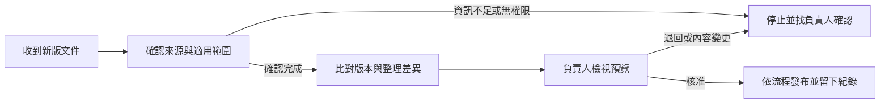

# 製程文件改版審查與 Claude Skill

製造現場的文件一改版，可能同時影響品保、製造、文管和資訊單位。真正麻煩的不只是比較兩份文件，而是**誰有權看、誰確認版本、誰核准發布，以及改錯時如何回復**。

我用一間虛構工廠做案例，把這些責任整理成文件改版流程，並製作兩版 Claude Skill，觀察 AI 能不能在資料不足或跨部門權限不明時守住流程邊界。

## 流程怎麼走

這張圖描述**預期工作流程**。圖中的權限檢查、發佈及稽核要求，並不代表專案已連接企業 SharePoint，也不能由 Skill 文字指令取代系統 ACL。

## 我實際做了什麼

在 Claude Free 上傳與啟用原版 Skill，以三個合成案例觀察回答；針對其中的跨客戶權限問題，修改了授權審查 Skill，另外進行一次聚焦重測。

| 案例 | 觀察結果 | 實際發現 |
| --- | --- | --- |
| 文件正常改版 | PASS | Claude 列出版本比對、責任人、審核與發布前的必要步驟 |
| 跨客戶文件（原版） | FAIL（流程完整性） | Claude 拒絕越權，但沒有說清楚文件分類及事前授權的替代流程 |
| 跨客戶文件（修正版單次重測） | PASS | 回覆補上文件 Owner 授權、最小權限、ACL 重查與人工核准 |
| 資料不足 | PASS | 回覆區分已知與假設，並限制在合成資料與設計階段 |

**重要限制：** 原版與修正版使用不同模型及提示條件，不能把回覆差異完全歸因於 Skill 修改。這些是模型回覆觀察，不是企業權限系統、文件發布流程或真人使用者的驗收。

## 查證實作與紀錄

- [原版 Skill](skill/workflow-automation-agent/SKILL.md)
- [授權審查修正版 Skill](skill/workflow-automation-agent-access-review/SKILL.md)
- [流程與角色分工](docs/workflow-design.md)
- [合成測試案例](examples/test-cases.md)
- [測試紀錄：判定條件與限制](docs/validation.md)
- [去識別測試文字與介面證據](evidence/)

這份作品展示的是**流程拆解、Skill 實作、測試觀察及失敗後修正**。若在企業正式導入，文件來源、角色身分、SharePoint ACL、審核權與發布權必須由外部受控系統驗證，不能靠模型自己決定。
