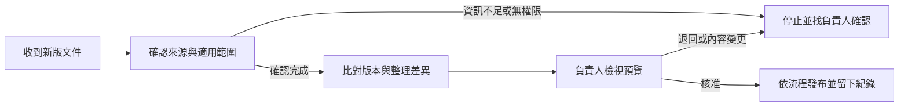

# 製程文件改版審查流程

製造現場的文件一改版，常會牽動品保、製造、文管和資訊單位。這個作品用一間虛構工廠做例子，整理新版本從收到、比對到核准發布的流程，也說明哪些人要參與、哪些資料不能跨權限流動。

## 流程怎麼走

這是流程設計圖。圖中的權限檢查與發布步驟描述預期做法，不代表已連上企業 SharePoint。

## Claude 測試

我在 Claude Free 上傳並啟用兩版 Skill，使用合成案例實際測試：

- **一般改版：** Claude 整理了版本比對、負責人審查及核准後發布等步驟。
- **跨客戶文件：** 原版有拒絕越權，但沒有交代清楚分類和事前授權。補上這些步驟後，修正版的單次重測列出 Owner 授權、限時權限、重新確認 ACL，以及發布前審核。
- **資料不足：** Claude 有區分已知與假設，並把規劃限制在合成資料。

原版 T2 和修正版重測使用的模型不同，提示內容也有差異，所以這次結果不能單獨證明差異是 Skill 修改造成的。測試只觀察 Claude 的回答，沒有驗證企業權限或實際發布流程。

## 專案檔案

- [流程設計與分工](docs/workflow-design.md)
- [原版 Skill](skill/workflow-automation-agent/SKILL.md)
- [授權審查修正版 Skill](skill/workflow-automation-agent-access-review/SKILL.md)
- [合成測試案例](examples/test-cases.md)
- [測試紀錄](docs/validation.md)
- [回答文字與介面證據](evidence/)

